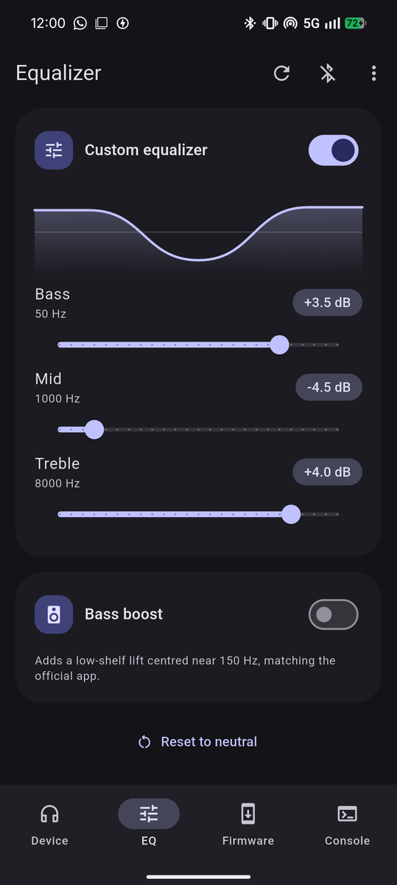
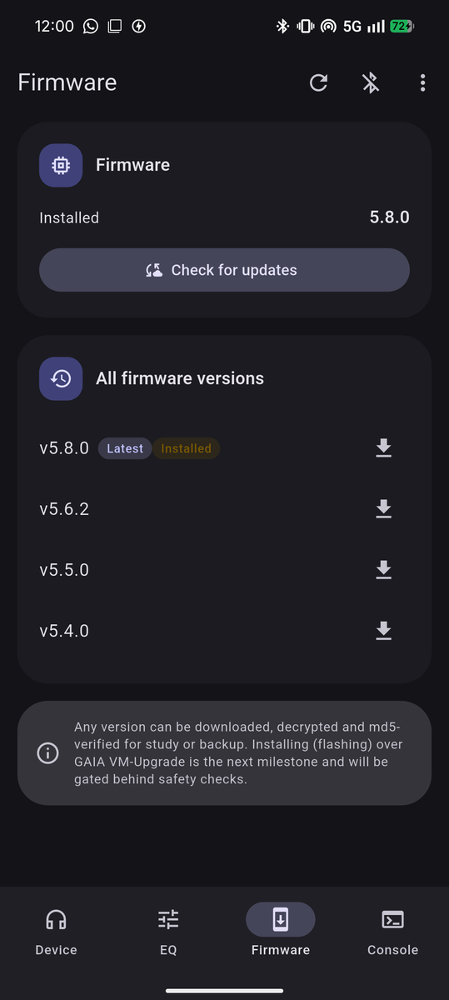

# OpenHD350B

An open-source replacement for the Sennheiser **Smart Control** app, built with
Flutter. It targets the **HD 350BT** (model SEBT3, article 300002) and other
Qualcomm-GAIA Sennheiser headphones, so the hardware stays usable and
configurable after the official app is discontinued.

This is an interoperability and repair project for hardware you own. It talks to
the headphones with Qualcomm's GAIA protocol, reverse-engineered from the
official app and verified against a real device. It installs only **official,
signed** firmware — the chip validates the image signature itself, so nothing
here circumvents a security control.

## Status

Working against a real HD 350BT (firmware 5.8.0):

- **Connect** over BLE (GAIA service `0xFDCE`, GAIA v1/v2 framing) with explicit
  bonding, so the pairing is never disturbed.
- **Dashboard** — model, firmware, battery + charging, signal, audio mode, sidetone.
- **Equalizer** — 3-band (Bass / Mid / Treble) with the device's real shelf-filter
  math, bass boost, and custom-EQ toggle, verified by ear on the device.
- **Firmware** — list every cloud version, download, decrypt, md5-verify and save
  any version to the phone; over-the-air app self-update from GitHub Releases.
- **Debug console** — raw GAIA traffic, hex send, and a read-command verification sweep.

Planned: the GAIA VM-Upgrade firmware installer.

## Screenshots

| Device | Equalizer | Firmware |
|---|---|---|
|  |  |  |

## How it works

| Layer | Where |
|---|---|
| GAIA framing (v2 + v3) and request/response client | `lib/core/gaia/` |
| BLE / fake transports | `lib/core/transport/` |
| Command map (names → IDs, with verification status) | `lib/core/gaia/command_table.dart` |
| HD 350BT equalizer math | `lib/features/equalizer/eq_engine.dart` |
| Typed device session | `lib/features/device/` |
| UI (dashboard, EQ, console, shell) | `lib/ui/` |

Command IDs and the EQ algorithm were recovered from Smart Control 4.7.0 (a
NativeScript app; logic in `assets/app/bundle.js`) and confirmed on-device. The
reverse-engineering brief is in [`build-spec.md`](build-spec.md); the Bluetooth
HCI capture procedure is in [`docs/hci-capture.md`](docs/hci-capture.md).

`sennheiser_fw.py` is a standalone reference tool that downloads and decrypts
official firmware packages from Sennheiser's cloud.

## Build & run

```sh
flutter pub get
flutter run        # Android device with Bluetooth; pair the HD 350BT first
flutter test
```

Requires an Android device (BLE permissions are configured for Android 12+ and
legacy). The headphones must already be paired in the system Bluetooth settings.

## Legal & ethical note

For interoperability and repair of hardware you own. Installs official signed
firmware only; no security control is bypassed. Not affiliated with or endorsed
by Sennheiser; product names and images are the property of their respective
owners.

## License

MIT — see [`LICENSE`](LICENSE).
